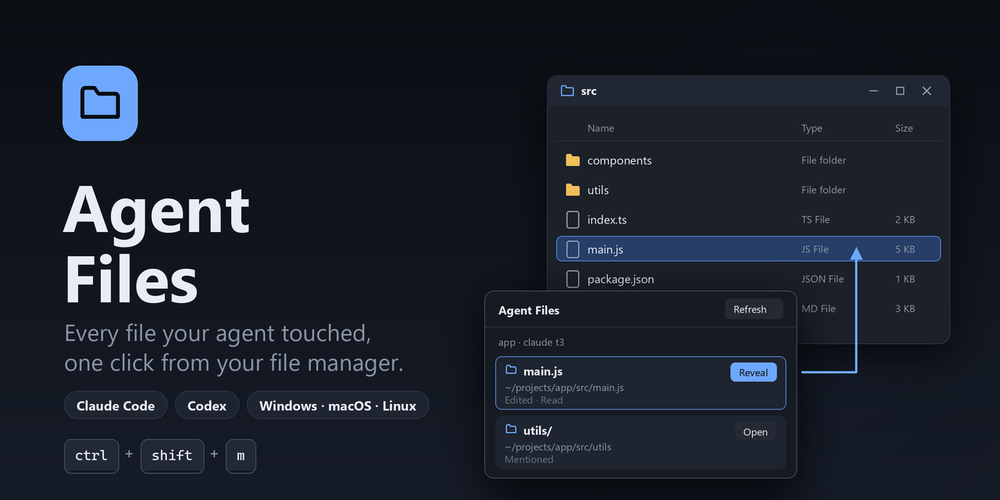
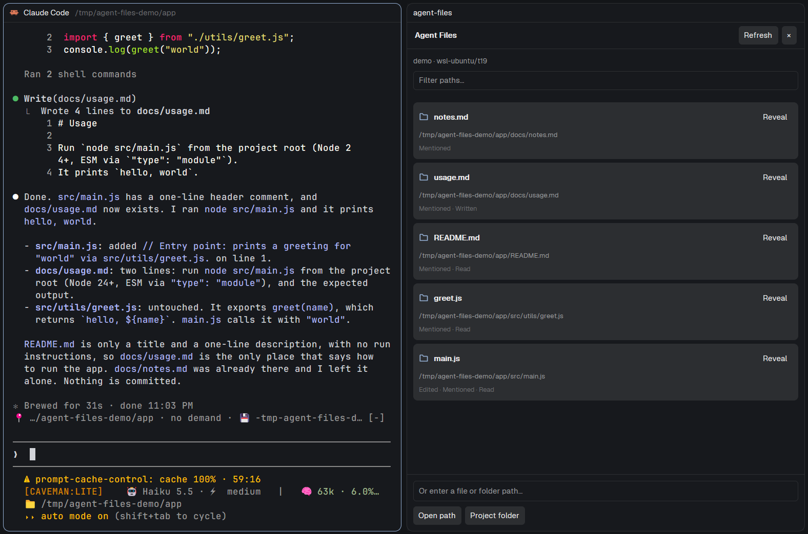

<p align="center">
  
</p>

# Agent Files

A [Herdr](https://herdr.dev) desktop mod that lists the files your coding agent read, edited, wrote or mentioned in the current session, and opens any of them in your desktop file manager: **Explorer** on Windows, **Finder** on macOS, your default file manager on Linux.



## Features

- **One key, one pane.** `ctrl-shift-m` opens the panel beside your terminal; press it again to close it. The keyboard stays in your terminal.
- **Follows the agent you are looking at.** Claude Code and Codex sessions are read straight from their own session files. No hooks, no commands, nothing to set up inside the agent.
- **Every path the agent touched.** Each entry says how it got there: Read, Edited, Written, Tool or Mentioned. The newest is on top, and a filter box narrows the list.
- **Reveals files, never launches them.** A folder is opened; a file is shown selected in its folder (`explorer.exe /select,` on Windows, `open -R` on macOS, the parent folder on Linux).
- **Works across machines.** A Windows desktop with a WSL machine space gets `\\wsl.localhost\...` paths converted for Explorer. A manual path box and **Project folder** cover everything else.
- **No dependencies.** Plain JavaScript, `sh`, and on Windows the built-in PowerShell. No Python, no network.

## Supported agents

| Agent | Session read from | Matching the terminal |
| --- | --- | --- |
| Claude Code | `~/.claude/sessions/<pid>.json` and `~/.claude/projects/<folder>/<session>.jsonl` | Linux/WSL: exact (the process carrying the terminal's `HC_TERMINAL_ID`). Elsewhere: the newest live session in the terminal's folder. |
| Codex | `~/.codex/sessions/**/rollout-*.jsonl` | Linux/WSL: exact (the rollout file the Codex process holds open). Elsewhere: the newest session in the terminal's folder. |
| Gemini CLI | not yet | The panel says it is not supported. |

These are the agents' own session formats, not public APIs: an agent update can change them.

## Requirements

- The Herdr desktop app on Windows, macOS or Linux.
- Windows: PowerShell (built in). A WSL machine space also uses `wslpath` (built into WSL).

## Install

With the app open, ask the agent in your Herdr window to *add the mod at github.com/bersimao/herdr-agent-files*, or do it by hand:

```sh
git clone https://github.com/bersimao/herdr-agent-files.git
cp -r herdr-agent-files/mods/agent-files ~/.config/herdr-app/mods/
herdr-app check ~/.config/herdr-app/mods/agent-files
```

Then merge this repository's `keys.json` into `~/.config/herdr-app/keys.json` (pick another key if you already use `ctrl-shift-m`).

## Keys

| Key | Does |
| --- | --- |
| `ctrl-shift-m` | Open the panel beside the focused pane, or close it |
| `Enter` in the path box | Open that path |

## How it works

The key runs `mod.open:agent-files`. The mod starts as an invisible launcher: it closes the panel if this tab has one, otherwise it splits a pane with the panel, then closes itself.

Sessions are read where the agent runs (`exec` and files on that machine), 4 MiB at a time and only from where the last read stopped. The file manager always runs on the desktop you are looking at.

| Desktop | Agent on | Reads with | Opens with |
| --- | --- | --- | --- |
| Windows | this computer | `agent-files.ps1` | `explorer.exe` |
| Windows | a WSL machine | `sh` + `wslpath` | `explorer.exe` |
| macOS | this computer | `sh` | `open` / `open -R` |
| Linux | this computer | `sh` | `xdg-open` |
| any | an SSH machine | `sh` | not possible: its files are not on your desktop, so Reveal is hidden |

## Privacy and safety

The mod runs programs (`sh`, `powershell.exe`, `explorer.exe` / `open` / `xdg-open`) and reads your agents' session files under `~/.claude` and `~/.codex`. Nothing leaves your computer: there is no network access.

## Tested

Windows (a native PowerShell Claude Code session, and Claude Code and Codex in a WSL machine space) is tested. macOS and Linux follow the same code paths but are untested on real machines. Reports and fixes are welcome.

[RECIPE.md](RECIPE.md) is the brief to build this mod from scratch.

## License

[MIT](LICENSE).
