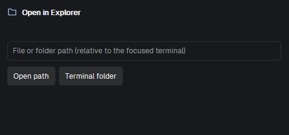

# Open in Explorer

A small dialog that opens any file or folder from your terminal in the desktop's file manager: Explorer on Windows, Finder on macOS, your default file manager on Linux. Type a path (relative paths resolve against the focused terminal's folder) or click "Terminal folder". Files are revealed (selected) in their folder; folders are opened.

## What you see
A centered dialog, 480 x 230 px, on the surface color:
1. Header: folder icon (accent color, 16 px) and "Open in Explorer" (semibold).
2. A muted, single-line label with the focused terminal folder, or a hint to use absolute paths when none is known.
3. A 32 px path input with the placeholder "File or folder path (relative to the focused terminal)".
4. Two buttons: "Open path" and "Terminal folder" (raised background, hover color).
5. A muted notice line, only when there is something to say.

## How it behaves
- Enter in the input, or "Open path": resolves the path, then opens it. "Terminal folder" opens the focused terminal's folder.
- Accepts `~/x`, relative paths, absolute paths, and on a Windows desktop also `C:\x`. A WSL machine's Linux paths are converted to Windows paths.
- Success closes the dialog. Failure keeps it open with a notice: "Path does not exist.", "Path cannot be resolved.", "No terminal folder is known: enter an absolute path." (relative path with no known terminal folder), or "Remote machines are not supported..." (macOS/Linux desktop with an SSH machine: its files are not on this desktop).
- Opening: Windows `explorer.exe <dir>` or `explorer.exe /select, <file>` (exit code 1 is normal); macOS `open <dir>` or `open -R <file>`; Linux `xdg-open <dir>` (a file opens its parent folder, Linux has no standard "select").
- Opens only what exists. Never launches a file: a file is only revealed.

## Built from
- `mods/open-in-explorer/main.js`: one `View`. `exec` runs the helpers; `spaces()`, `panes()`, `focused()` give the machine and the focused terminal's `cwd`; `closeOverlay(props().overlay)` closes the dialog.
- `mod.json`: `{ "place": "none", "overlay": { "width": 480, "height": 230 } }`.
- `resolve.ps1`: Windows-only helper (local Windows terminals). Prints `d` or `f`, then the full path. Exit 4 invalid, 5 missing.
- `folder.svg`: the icon.
- Platform: `exec("uname", ["-s"])` — Darwin = macOS, success otherwise = Linux, start failure = Windows.
- Resolution happens where the terminal runs (`exec(..., { on: machine })`); opening always happens locally.
- `keys.json` (optional): `ctrl-shift-e` -> `mod.open:open-in-explorer`.

## Watch out
- Runs programs (`exec`: `uname`, `sh`, `powershell.exe`, `explorer.exe`/`open`/`xdg-open`). It reads no files outside its folder and uses no network.
- dash's `echo` mangles backslashes: the shell helpers use `printf '%s\n'`.
- Pass paths to `sh -c` as positional arguments (`$1`, `$2`), never interpolated into the script.
- The macOS and Linux branches are untested on real macOS; the Windows and WSL paths were tested.

## Done when
- `herdr-app check mods/open-in-explorer` passes.
- `mod.open open-in-explorer` shows the dialog; Esc closes it.
- `~`, a relative path, an absolute path and a missing path behave as above; a file is selected in its folder, a folder is opened.
- On a Windows desktop with a WSL machine space, `~/x` opens `\\wsl.localhost\...\x` in Explorer.
